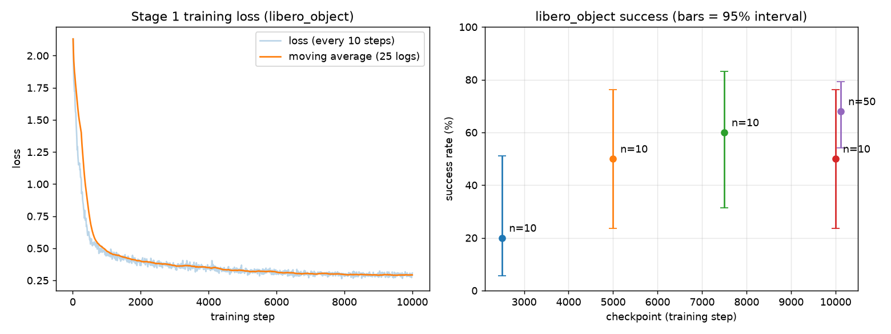
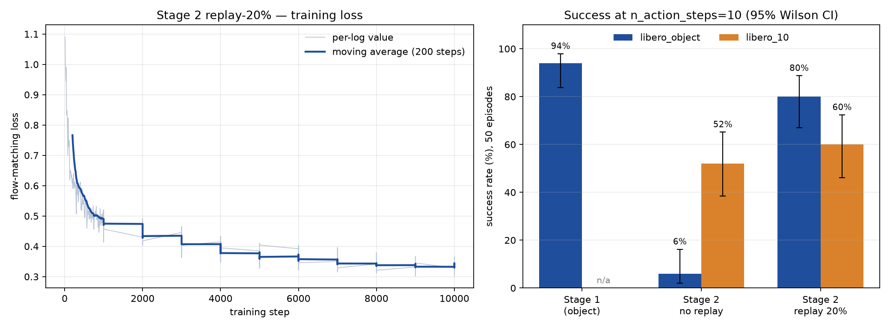
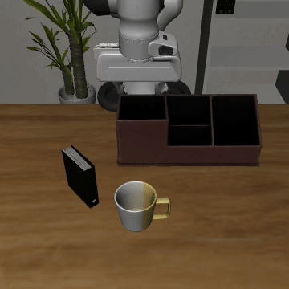
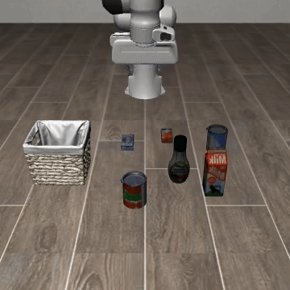

# SmolVLA vs ACT on LIBERO: continual skill learning

Staged training of SmolVLA (LeRobot) on LIBERO suites in MuJoCo, testing how much an
earlier suite is forgotten when training moves on, and whether replay prevents it.

## Setup
- Ubuntu 24.04, RTX 5050 laptop GPU (8 GB), Python 3.12, MuJoCo with `MUJOCO_GL=egl`
- LeRobot 0.7.1 (editable install, exact commit in `lerobot_commit.txt`), pinned packages in `requirements.txt`
- SmolVLA trained with the VLM frozen (`train_expert_only`), about 100M learnable parameters
- Every evaluation: 5 episodes per task, 50 per suite, 95% Wilson intervals

## SmolVLA stage comparison

All rows evaluated at `--policy.n_action_steps=10`.

| Stage | Starts from | Training data | Steps / batch | libero_object | libero_10 |
|---|---|---|---|---|---|
| 1: object | scratch (VLM weights loaded) | 454 libero_object episodes | 10,000 / 16 | **94%** (47/50, CI 84-98%) | not evaluated |
| 2a: libero_10, no replay | stage 1 | ~379 libero_10 episodes | 10,000 / 16 | **6%** (3/50, CI 2-16%) | **52%** (26/50, CI 39-65%) |
| 2b: libero_10 + 20% object replay | stage 1 | libero_10 + 91 object episodes (~470) | 10,000 / 16 | **80%** (40/50, CI 67-89%) | **60%** (30/50, CI 46-72%) |

Without replay the earlier suite is almost entirely forgotten. Mixing in 20% of the old
episodes retains most of it (80% vs 94%, a small loss) and does not hurt the new suite.

### Effect of execution length (`n_action_steps`)
The model predicts 50-step action chunks; how many are executed before re-planning matters a lot.

| Model | n_action_steps=50 (default) | n_action_steps=10 |
|---|---|---|
| Stage 1 on libero_object | 68% (34/50) | **94%** (47/50) |
| Stage 2a on libero_object | 2% (1/50) | 6% (3/50) |
| Stage 2a on libero_10 | 32% (16/50) | 52% (26/50) |

### Stage 1 learning curve (libero_object, n_action_steps=50, 10 episodes per point)
2,500 steps: 20% | 5,000: 50% | 7,500: 60% | 10,000: 50% (10 eps) / 68% (50 eps)

## Figures



## Example rollouts
Successful episodes from the stage 2 (replay) model:

| libero_10 (new skill) | libero_object (old skill retained) |
|---|---|
|  |  |

## Reproducing
```bash
source ~/smolvla/bin/activate; export MUJOCO_GL=egl
# stage 1
lerobot-train --policy.type=smolvla --policy.load_vlm_weights=true --policy.push_to_hub=false \
  --dataset.repo_id=lerobot/libero --dataset.episodes="$(cat splits/object_episodes.json)" \
  --dataset.video_backend=torchcodec --output_dir=./outputs/object10k --steps=10000 --batch_size=16
# stage 2 with replay (episode list = libero_10 + random 20% of object episodes)
lerobot-train --policy.path=./outputs/object10k/checkpoints/010000/pretrained_model --policy.push_to_hub=false \
  --dataset.repo_id=lerobot/libero --dataset.episodes="$(cat splits/long10_replay20.json)" \
  --dataset.video_backend=torchcodec --output_dir=./outputs/stage2_replay20 --steps=10000 --batch_size=16
# evaluation
lerobot-eval --policy.path=./outputs/stage2_replay20/checkpoints/010000/pretrained_model \
  --policy.n_action_steps=10 --env.type=libero --env.task=libero_object \
  --eval.batch_size=1 --eval.n_episodes=5 --env.max_parallel_tasks=1
```

## Layout
`scripts/` helper tools (video listing, action traces, plots) | `splits/` episode-id lists |
`logs/` training and evaluation logs | `results/` figures and example video

## ACT baseline
Experiments are in progress and will be documented later.
